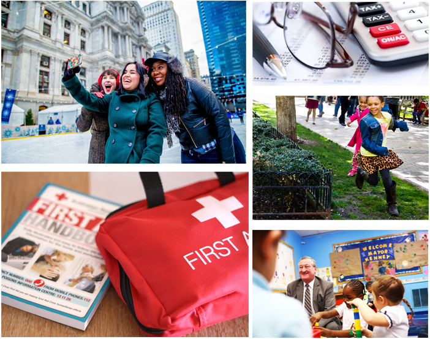

## Overview
Photography brings another dimension to the City’s brand identity. Pictures should be expressive, show real people and emotions, and be cropped for greatest effect. Aim for a photojournalistic approach, creating a sense of place, and showing real-life interactions between people. Never use a photo that’s contrived or cliched. Dynamic lines, angles and cropping give images personality.

In general:
- Use photographs that have been taken in Philadelphia.
- Use imagery that is not visibly dated.
- Include credit where photo credit is due.

**We do not rely on imagery** to communicate processes or other information on phila.gov. Images should support text content or be accompanied by a text equivalent.

## Guidelines

Most often, photos featured on phila.gov will accompany a blog post. However, images may be embedded into a page alongside body text in certain cases.

Featured images must:
- Be a photograph.
- Be landscape oriented.
- Be at least 1000 px wide x 570 px tall.
- Be at least 300 dpi.
- Include alternative (alt) text.

Do not use images that:
- You don't have the rights to use (e.g., an image copied from Google images).
- Are AI-generated or contain AI-generated elements.
- Are too small, low-quality, or pixelated.
- Are flyers or images meant for social media.
- Contain text or graphics (including logos).

Flyers or graphics created for social media cannot be posted as images anywhere on phila.gov. These images will generally not comply with City’s digital accessibility policy or resize appropriately on phila.gov.

---




  
  
  


{}
## Implementation
All images are required to have alternative text (also called alt text).

Good alt text describes the image within its surrounding context. For example, a headshot of a person should contain the person's name. Never start alt text with "photo of" or "image of."

**Example:** ``

If an image contains text, like a logo, that text must be the alternate text.

**Example:** ``

If the image is purely visual and does not contain meaningful information, the alternate text can be blank, but the attribute must be present. This indicates to screenreaders that the image is "decorative" or not important to understanding the content on the page.

**Example:** ``

You can read more about alternate text on the <a href="http://webaim.org/techniques/alttext/" class="external">WebAIM website</a>.
{}


